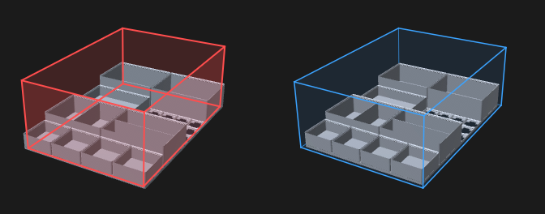
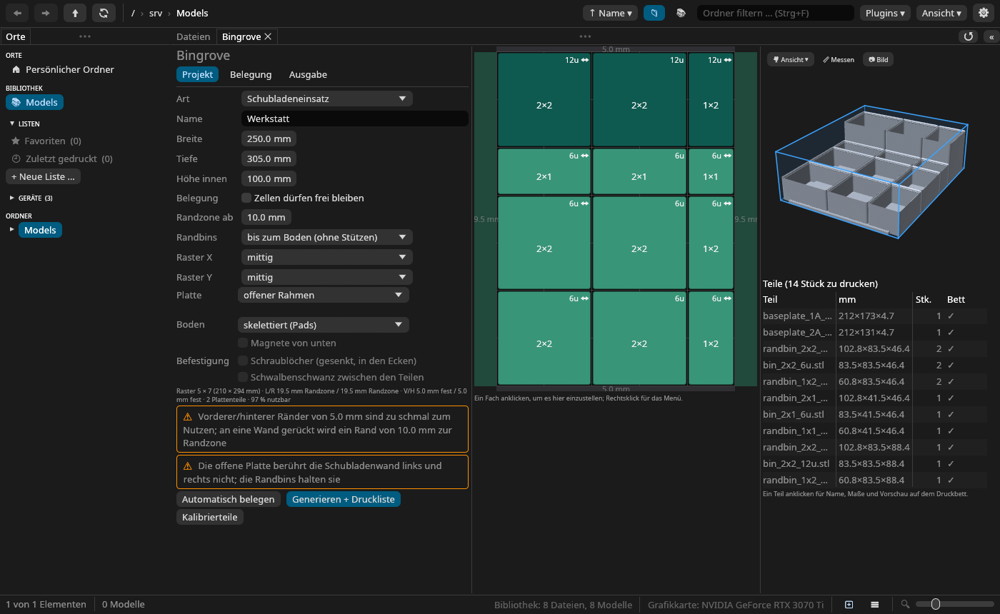

<p align="center"></p>

# Bingrove

**Gridfinity für Schubladen, Werkbänke und Wände.** Du gibst Bingrove ein Maß und was hinein
soll; es plant Baseplate, Bins und Halter, erzeugt die Dateien (eine STL je Teil, eine 3MF je
Druckbett) und setzt sie auf Drucklisten. Es läuft als Plugin in
[Meshgrove](https://github.com/DonDavis-vibe/MeshGrove), von der Kommandozeile oder über eine AI
wie Claude.

*English version: [README.md](README.md)*

## Drei Arten von Projekt

### Schublade: die ganze Schublade nutzen

Ein 42-mm-Raster passt selten in eine Schublade. In eine 250 × 305 mm große Schublade passt ein
5 × 7-Raster, und **links und rechts bleiben je 19,5 mm**, die nichts halten. Bingrove lässt das
Raster, wo es ist, und lässt die Bins neben einem breiten Rand in ihn hineinreichen
(*Randbins*, `randbin_…`). Die inneren Bins bleiben reines Gridfinity, jeder Bin von anderswo
passt weiter. In dieser Schublade steigt die nutzbare Fläche von 83 % auf 97 %.

```
hinten
 #################        ~  Randzone, in die Bins reichen
 ~ A  A  B  B  C ~        #  fester Plattenrand (zu schmal zum Nutzen)
 ~ A  A  B  B  C ~
 ~ D  E  E  F  F ~        A: randbin_2x2_12u_L19.25.stl   D: randbin_1x5_6u_L19.25.stl
 ~ D  E  E  F  F ~        B: bin_2x2_12u.stl              E: bin_2x3_6u.stl
 ~ D  E  E  G  G ~        C: randbin_1x2_12u_L19.25.stl   …
 ~ D  I  K  M  O ~
 ~ D  H  J  L  N ~
 #################
vorne
```

Der Überstand reicht entweder auf einer Schürze **bis zum Schubladenboden** (Standard, druckt
ohne Stützen, 4,75 mm mehr Höhe), **liegt** auf dem Plattenrand auf (braucht Stützen), oder es
gibt **keine Randbins** und der Rand bleibt Platte. Ränder unter 10 mm (einstellbar) bleiben
immer Platte, damit der Einsatz nicht rutscht.

### Fläche: Werkbank oder Tisch

Die Platte ist das Raster selbst, Zellen × 42 mm, ohne Rand. Du gibst die Fläche in mm an und
bekommst so viele Zellen, wie hineinpassen, oder du stellst die Zellen selbst ein. Sind es mehr,
als die Fläche fasst, warnt der Plan, und die Vorschau zeigt, wo die Platte übersteht. Zellen
bleiben frei, wo nichts hinkommt. Die Platte bekommt einen festen Boden (skelettiert oder voll), gesenkte
M4-Schraublöcher, Schwalbenschwanz-Verbinder zwischen den Teilen und für Blechflächen
Magnettaschen von unten.



### Wand: Teile, die einhängen

Eine Platte an der Wand mit zwei Haken (unten und oben) und einem Federblatt in jeder Zelle.
Wandteile sind oben 4 mm kürzer: Du schiebst sie **bis zum Anschlag hoch, setzt sie gerade ein
und lässt sie hinunterrutschen**. Die Haken halten sie dann gegen geradeaus Abziehen und gegen
Kippen, und eine **Raste klickt ein**, damit das Teil nicht mitkommt, wenn du ein Werkzeug nach oben herausziehst. Zum
Herausnehmen hebst du das Teil fest an. Magnete helfen. Ohne Haken halten die Teile nur über
Magnete, dann passt auch jeder Bin.

Wie fest die Raste hält und wie viel Spiel der Haken hat, stellst du unter *Ausgabe* ein
(*Raste*, *Hakenspiel*); die Kalibrierteile zeigen, was zu deinem Drucker passt.

Die Platte wird angeschraubt (Löcher in der Mitte der Eckzellen) oder mit gedruckten Haken, die
in ihre Oberkante geschoben werden, an eine **IKEA-Skadis**-Lochplatte gehängt. Wandteile
drucken auf ihrer Unterseite liegend, ihre Taschen öffnen sich beim Druck also nach oben.

## Installieren

Bingrove braucht Meshgrove **0.8.0 oder neuer**. Nimm 0.8.2 oder neuer: Dort übernehmen
Zahlenfelder den Wert erst nach Enter, Tabellenspalten lassen sich aufziehen, und das Panel zeigt,
ob deine Dateien wirklich in der Bibliothek angekommen sind.

1. `bingrove.wasm` und `bingrove.wasm.sha256` von den
   [Releases](https://github.com/DonDavis-vibe/Bingrove/releases) laden und den Download
   prüfen:
   ```bash
   sha256sum -c bingrove.wasm.sha256
   ```
2. `bingrove.wasm` nach `~/.local/share/meshgrove/plugins/` kopieren.
3. In Meshgrove *Einstellungen → Plugins* öffnen, Bingrove installieren und „AI-Tools“ und
   „Dateien in die Bibliothek legen“ freigeben.
4. Öffnen mit *Plugins ▾ → Bingrove*.

Selbst bauen: siehe [Entwicklung](#entwicklung).

## Das Panel



Das Panel hat drei Teile:

- **Links** drei Reiter. *Projekt*: Art (Schublade, Fläche, Wand), Name, Maße, Ränder und
  Platte. *Belegung*: wie viele Fächer du möchtest; Bingrove schlägt die gleichmäßigsten
  Mischungen von Bin-Größen vor, die das Raster füllen („10 × 3×1“, „5 × 2×2 + 5 × 2×1“ …), ein
  Klick belegt so. *Ausgabe*: Drucker, Drucklisten, Magnetmaße. Unter den Reitern stehen die
  Zusammenfassung des Rasters, Warnungen und die Knöpfe *Automatisch belegen* (neu belegen),
  *Generieren + Druckliste* und *Kalibrierteile*.
- **Mitte** der Plan als Raster-Editor. Ziehen verschiebt, eine Kante ziehen ändert die Größe,
  auf freien Zellen ziehst du neue Bins auf, Rechtsklick öffnet ein Menü. Ein Klick auf einen Bin
  öffnet darunter seine Einstellungen: Höhe, Fächer, Label-Lasche, Griffmulde, Gravur, Halterart
  und die eigenen Maße des Halters.
- **Rechts** die 3D-Vorschau und die Teileliste. Um den Zusammenbau steht blau der Raum, für den
  du planst: die Schublade innen, die Fläche mit dem Platz darüber, die Wand mit dem Platz davor.
  Wo Platte oder Bins herausragen, wird er rot (ab Meshgrove 0.9.0). Ein Klick auf ein Teil zeigt
  es auf dem Druckbett, darunter seinen vollen Namen und die genauen Maße.

**Generieren + Druckliste** schreibt alles nach `Gridfinity/<Name>` in die Bibliothek und legt
zwei Drucklisten an: `<Name> – Teile` (jede STL mit Stückzahl) und `<Name> – Druckbetten` (eine
3MF je Bett, Teile angeordnet). Ein Klick im Verlauf von Meshgrove macht es rückgängig. Die
Projektdatei `*.gridfinity.json` öffnet sich aus der Galerie mit „Mit Bingrove öffnen“.

## Was entsteht

**Platten** werden entlang der Rasterlinien in Teile geschnitten, die auf deinen Drucker passen:
als offener Rahmen oder mit Boden und Magnetlöchern. Schwalbenschwanz-Verbinder halten die Teile
zusammen: Ein Teil wird auf den Zapfen des anderen gelegt.

**Bins** haben Stapelrand, Fächer, Label-Lasche und Griffmulde an jeder Wand, Magnetlöcher, eine
offene Front, Fingerausschnitte in den Trennwänden und ein schräges Fenster. Ein
**Aufsteckdeckel** trägt oben den Stapelrand, so dass ein weiterer Bin darauf steht. Für
bestimmte Dinge lassen sich Taschen ausschneiden: Box, Zylinder, Polygon oder die Umrisse eines
Modells aus deiner Bibliothek. Text wird in einer Strichschrift (Hershey Simplex) in die
Label-Lasche oder die Front graviert.

**Halter** ersetzen einen Bin auf seinen Zellen. Jeder hat Sätze zum Laden, und seine Maße
bleiben änderbar:

| Halter | Für | Du stellst ein |
|---|---|---|
| Lochraster | Akkus, Stifte, Fräserschäfte, Bohrer | Durchmesser, Tiefe, Teilung, Anzahl, Form (rund, Sechskant, quadratisch) |
| Lochreihe | Nüsse, Schraubendreher, Bohrer, Inbus | Größe je Loch (graviert), Reihen, Stufen, Neigung oder Vierkant-**Stecker** je Antrieb |
| Wiegen | Verlängerungen, Ratschen, Feilen liegend | Breite × Länge je Platz, Neigung, Stufen |
| V-Schlitze | Zangen, Scheren, Schlüssel stehend | Dicke × Tiefe je Schlitz, Rampe, hinten geschlossen |
| Schlitze | Karten, SD-Karten, Swatches, Knopfzellen, Sägeblätter | Breite, Tiefe, Teilung |
| Ringe | Flaschen, Spraydosen, Kabelrollen | Durchmesser, Höhe |
| Rinnen | Stifte und Schraubendreher liegend | Durchmesser, Länge, Griff |
| Bits, Tape | 1/4"-Bits, Tape-Rollen auf Dornen | Anzahl, Rollengröße |

An der Wand gibt es neben offenen **Ablagen** auch **Schütten**: vorne niedrig, die Seiten
schräg bis zur Wand, wie Lagersichtkästen.

**Wandhalter** hängen an einer Wandplatte:

| Halter | Für | Du stellst ein |
|---|---|---|
| Löcher stehend | Schraubendreher (hängen durch), Stifte, Feilen | Durchmesser, Tiefe, Anzahl, Neigung von der Wand weg |
| Fassungen lehnend | Verlängerungen, Inbus | Größe je Platz (graviert), Neigung zur Wand, Stufen |
| V-Schlitze | Zangen und Scheren mit den Backen nach unten | Dicke × Tiefe je Schlitz, Länge, vorne geschlossen |
| Haken und Bügel | Hammer (Gabel), Kabel und Schläuche (Bügel), alles zum Aufhängen | Arme, Abstand, Ausladung, Spitze, Armstärke |
| Köcher | Lineale, lange Bits, Pinsel, Stifte, Spraydosen | Ø und Text je Röhre, Tiefe, Wand, unten offen |

Sätze gibt es für Nüsse auf 1/4", 3/8" und 1/2" (metrisch und zöllig, in Löchern oder auf
Steckern), Inbus, Bohrer, Schraubendreher, Verlängerungen, Ratschen, Zangen, Scheren,
Maulschlüssel 6–24, Dosen, Flaschen und Kabelrollen, und dasselbe für Wände, dort dazu Einzel-
und Doppelhaken, eine Hammergabel, einen Kabelbügel und Köcher für Stifte, Pinsel, lange Bits
und Spraydosen.

**Kalibrierteile** stellen den Drucker vor dem großen Druck ein: eine Magnetloch-Leiter, ein
Passungstest mit drei Bins unterschiedlicher Luft, ein Verbinder-Paar, ein Riegel mit
Nuss-Steckern und eine Wandzelle mit sechs Klötzen: drei mit unterschiedlicher Luft um den Haken,
drei mit unterschiedlich fester Raste.

**Ausgabe**: eine STL je Teileart mit Stückzahl, eine 3MF je Druckbett, der Zusammenbau als 3MF
zum Anschauen (eine Wand steht aufrecht) und die Projektdatei.

## Mit einer AI

Meshgroves Chat und sein MCP-Server (`meshgrove-mcp`, für Claude Code, Claude Desktop, LM Studio
und andere) sehen drei Tools:

| Tool | Was es tut |
|---|---|
| `bingrove_options` | Presets, deine Drucker, Halter und Sätze, Standardwerte, Grenzen |
| `bingrove_plan` | plant ohne Dateien: Raster, Teile, Textplan, Warnungen; schnell genug zum Iterieren |
| `bingrove_generate` | erzeugt die Dateien und übergibt sie Meshgrove als einen Vorschlag mit den Drucklisten |

Ein paar Anfragen und was daraus wird:

- *„Schublade 250 × 305 × 100 mm: Stifte, hinten zwei Kabelbins, ein Bitsatz 60 × 35 × 25 mm,
  sechs 18650-Zellen“*: eine Schublade mit diesen Dingen.
- *„Eine Werkbankplatte 600 × 300 mm mit einem 1/4"-Nusssatz und einer Reihe 8-mm-Fräser“*:
  `kind: surface` mit dem Satz `sockets_1_4_mm` und einem Lochraster.
- *„Eine Wand mit 8 × 6 Zellen für meine Verlängerungen, Zangen und zwei Ablagen“*:
  `kind: wall` mit den Sätzen `wall_extensions` und `wall_pliers` und zwei Bins.

Fotos laufen über den AI-Client: Er liest die Maße aus dem Bild und übergibt Zahlen.

## Kommandozeile

Der Befehl `bingrove` plant Schubladen und Flächen; Wände entstehen im Panel oder über die
Tools.

```bash
cargo build --release
target/release/bingrove presets
target/release/bingrove drawer 250x305x100 --name Kleinkram --inhalt "Stifte:20x180x20" --inhalt "2*Kabel:bin 2x2x12" --zusammenbau
target/release/bingrove drawer 600x300x100 --name Bank --flaeche --plan
target/release/bingrove bin 3 1 -d 3 1 --magnete ecken
target/release/bingrove tape 103 -n 2 1 -s 3
```

Die Dateien landen in `out/<Name>/`; `--plan` gibt nur den Plan aus.

## Entwicklung

```
crates/bingrove-core     Planung (Raster, Ränder, Teilung, Solver, Belegungsreparatur, Stückliste)
                         und mit dem Feature "geometry" die Körper und der STL-/3MF-Export
crates/bingrove-cli      der Befehl bingrove
crates/bingrove-plugin   das Meshgrove-Plugin (cdylib → bingrove.wasm, eigener Workspace)
assets/                  Icon und Banner
scripts/                 build.sh, install-into-meshgrove.sh, check.sh, release-notes.sh
```

```bash
rustup target add wasm32-wasip2
scripts/check.sh
scripts/build.sh
scripts/install-into-meshgrove.sh
```

`check.sh` fährt fmt, clippy (nativ und wasm), die Tests und den Plugin-Build; `build.sh`
schreibt `target/plugin/bingrove.wasm`, `install-into-meshgrove.sh` kopiert es in Meshgroves
Plugin-Ordner.

Das Plugin bezieht `meshgrove-plugin-api` aus dem Meshgrove-Repository, auf einen Tag
gepinnt. Für die Arbeit an beidem zeigt der Kommentar in `crates/bingrove-plugin/Cargo.toml`, wie
man es auf einen lokalen Checkout umbiegt. Die CI fährt `check.sh` bei jedem Push; ein Tag `v*`
baut das Plugin und veröffentlicht es mit Prüfsumme und Changelog-Eintrag als GitHub-Release.
Änderungen je Version: [CHANGELOG.md](CHANGELOG.md).

Die Geometrie läuft auf [manifold-rust](https://crates.io/crates/manifold-rust), einem reinen
Rust-Port von Manifold, also ohne C++-Toolchain, und derselbe Code baut für die Plugin-Sandbox.
Die Gridfinity-Profile folgen
[gridfinity-rebuilt-openscad](https://github.com/kennetek/gridfinity-rebuilt-openscad). Die
Schubladenlogik stammt aus einem Python-Script für zwei Schubladen, dessen 25 Teile die Tests
auf ±0,01 mm reproduzieren.

## Bekannte Grenzen

- Presets beschreiben nur Schubladen; eine Werkbank beginnt bei *Art → Fläche*, eine Wand bei
  *Art → Wand*.
- Bins sind Rechtecke. L-förmige Bins, Wandmuster, Lite-Bins, Schiebedeckel, Halbraster und ein
  Koffer mit Deckel fehlen noch.
- Lange Halter (ein ganzer Nusssatz) werden nicht fürs Druckbett geteilt; der Plan warnt.
- Der Umriss eines Bibliotheksmodells ist seine konvexe Hülle, Einbuchtungen werden aufgefüllt.
- Wandteile drucken auf ihrer Unterseite, runde Löcher werden daher leicht oval. Mit Haken
  passen nur Wandteile auf die Platte.
- Die Federblätter der Raste sind für PLA ausgelegt; PETG kriecht weniger, wenn Teile jahrelang
  hängen.
- Skadis-Haken halten die Platte nur an ihrer Oberkante (die Schlitze liegen 40 mm auseinander,
  das Raster 42 mm).
- Das Panel folgt der Sprache von Meshgrove, Deutsch oder Englisch. Datei-, Ordner- und
  Listennamen bleiben deutsch, damit bestehende Listen weiter passen, ebenso die Kommandozeile.

## Lizenz

MIT oder Apache-2.0 nach Wahl (`LICENSE-MIT`, `LICENSE-APACHE`). Die Gridfinity-Profile folgen
der veröffentlichten Spezifikation; Gridfinity ist von Zack Freedman, Bingrove steht in keiner
Verbindung zu ihm oder gridfinity.xyz. Die Gravur nutzt die Schrift Hershey Simplex: The Hershey
Fonts were originally created by Dr. A. V. Hershey while working at the U. S. National Bureau of
Standards; the format of the font data in this distribution was originally created by James
Hurt, Cognition, Inc.
